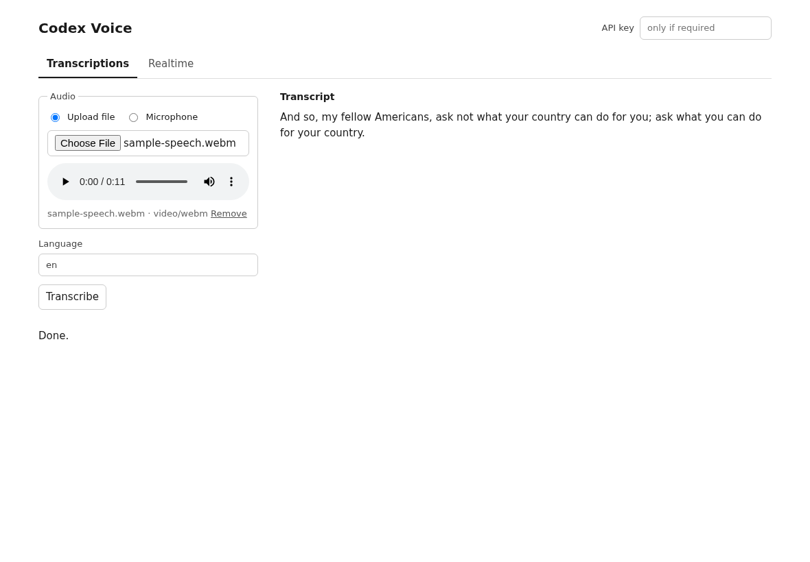
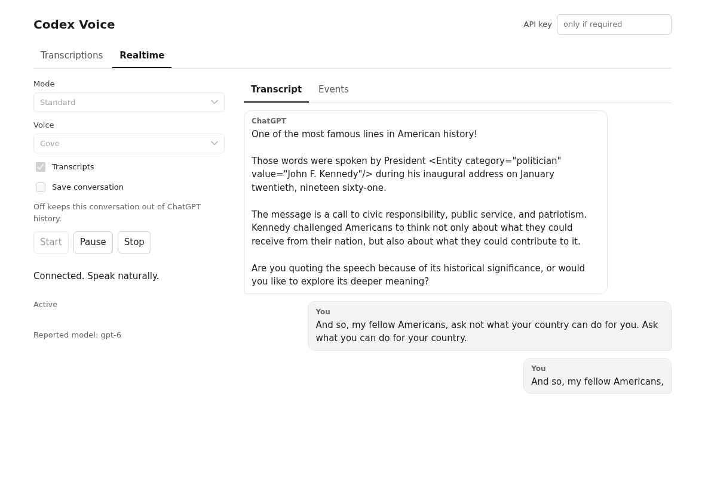

# Codex Voice

Codex Voice is an unofficial Rust server that uses your existing Codex ChatGPT
subscription login for audio transcription and voice conversations. It
reproduces the reverse-engineered flow used by the ChatGPT app through private
ChatGPT services. A Rust library and CLI are also included.

The server is the main product. Use its HTTP API from your own client, or open
the included browser demo to test transcription, voice mode, and whether your
account can access the requested features. You do not need to build a client
just to try the server. The demo is an optional convenience, not the product's
main interface.

This is not an official OpenAI integration or a separate source of subscription
access. Your account must have access to the requested feature. Private service
behavior can change. Codex Voice does not implement OpenAI's public Realtime
API. Its separate GPT-Live subscription mode uses the reverse-engineered
Quicksilver protocol and requires account access.

> Upstream usage limits still apply. Codex Voice does not remove account limits
> or provide unrestricted voice access. Availability depends on your plan,
> feature, mode, and upstream policy. See the official
> [ChatGPT Voice limits](https://help.openai.com/en/articles/20001274-chatgpt-voice)
> and the [quota boundaries](docs/voice.md#understand-upstream-usage-limits).

## Build and run

Install the pinned Rust 1.98.0 toolchain, CMake, Clang/libclang, and pkg-config.
From this checkout, build and install the binary:

```sh
cargo install --locked --path .
```

Use an existing Codex ChatGPT login stored in `$CODEX_HOME/auth.json` or
`~/.codex/auth.json`. An OpenAI project API key is not a substitute for that
login. To read another login file, pass `--auth-file /path/to/auth.json`.
The server reloads file auth for each request but does not refresh the login.

Supply a local server key through `CODEX_VOICE_API_KEY`, then start the server:

```sh
codex-voice serve
```

Open <http://127.0.0.1:2600/> and enter that local key in **API key**.
The server defaults to loopback port 2600, concurrency 1, a 10 MiB multipart
body limit, and upstream request and connect timeouts of 120 and 10 seconds.
Stop the server with Control-C. To run directly from source, use
`cargo run --locked -- serve`.

For trusted loopback use, you can explicitly disable the local key:

```sh
codex-voice serve --no-api-key
```

Keep the default loopback bind for local use. Before network exposure, configure
a local key, HTTPS, and access protection at your proxy or network boundary.
Browser microphone access requires localhost or HTTPS. Plain HTTP on a remote
LAN address does not qualify. See [configuration](docs/configuration.md) for
`--host`, `--port`, exact `--allowed-host` authorities, and Docker settings.

## Transcribe a file

The CLI prints plain text by default. Add `--json` for a JSON object:

```sh
codex-voice transcribe recording.wav --language en --json
```

For HTTP clients, use `POST /v1/audio/transcriptions` with a multipart file.
With the same local key supplied in your client environment:

```sh
curl --fail-with-body http://127.0.0.1:2600/v1/audio/transcriptions \
	-H "Authorization: Bearer $CODEX_VOICE_API_KEY" \
	-F 'file=@recording.wav;type=audio/wav' \
	-F language=en -F response_format=json
```

The response has the shape `{"text":"Recognized speech."}`. Omit Authorization
only for an explicitly keyless server. The body limit includes multipart overhead.
The API supports `json`, `text`, and `verbose_json`, without timestamps.
A multipart `model` value does not select the backend.

The [curl](examples/curl.sh), [Python](examples/python_openai_sdk.py), and
[Node](examples/node_openai_sdk.mjs) examples use this upload API.

## Use the browser demo

The optional, two-tab demo uses the server's documented HTTP API. It lets you
test your local server and account access without writing a client. In
**Transcriptions**, upload a file or select **Microphone**, record, and click
**Stop**. Preview the audio, then click **Transcribe**. Recording does not
automatically upload audio.



Real upstream transcription of a public JFK speech sample, captured on the
accepted UI revision. No private voice recording is shown.

In **Realtime**, Wingman and Cove are selected by default. **Save conversation**
starts off. Wingman and Advanced require you to enable saving explicitly before
**Start** becomes available. Choose Standard to start without saving to ChatGPT
history. **Transcripts** is independent of saving and starts on.

Click **Start**, allow microphone access, and wait for **Active**. Speaker bubbles
show the newest messages first. **Events** shows timestamped connection and
service events with formatted JSON details. **Pause** mutes the microphone and
playback locally. **Stop** closes the connection and releases the microphone.



**Example conversation.** Illustrative English dialogue rendered offline in the
actual Wingman UI with newest-first bubbles. No upstream calls were made and no
conversation was saved. This image does not verify API behavior.

Choose **GPT-Live (subscription)** for the separate Quicksilver path. Accept its
privacy notice before Start. The Save conversation switch does not apply because
no no-history setting is verified for this protocol. GPT-Live uses a server-held
sideband and browser-owned WebRTC audio. No backend agent or tools are attached.
Account rejection is an error; the server never falls back to a paid API or
another mode. Live audio acceptance and human microphone quality are separate
from offline tests. See the [GPT-Live API contract](docs/api.md#subscription-gpt-live).

The server's `POST /v1/realtime/sessions` accepts a JSON SDP offer and returns an
answer. WebRTC carries audio and events after negotiation. A curl request alone
cannot run a conversation. See the [voice guide](docs/voice.md) for lifecycle,
mode behavior, and integration limits.

## Reference

- [HTTP API](docs/api.md) covers routes, request fields, responses, errors, and limits.
- [Configuration](docs/configuration.md) covers login, local keys, CLI options, and exposure.
- [Voice guide](docs/voice.md) covers the demo, media lifecycle, Rust API, and verification.
- [macOS package](packaging/voice/README.md) describes the local launcher.
- [Roadmap](ROADMAP.md) tracks remaining acceptance and integration work.
- [Changelog](CHANGELOG.md) records changes and inherited release history.

Default Cargo features enable `server` and `realtime`. Disable default features
for an audio-only library. The crate is `codex_voice`.

## License

[MIT](LICENSE-MIT). The inherited contributors' copyright and full permission
notice remain unchanged. Adapted protocol work is credited in
[third-party notices](THIRD_PARTY_NOTICES.md).
